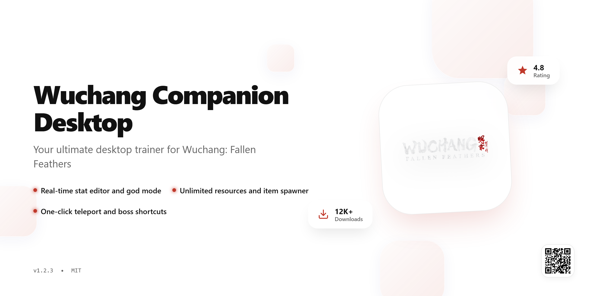

# ⚡ Wuchang Companion Desktop — Game Enhancer for Windows

### 🚀 PowerShell Quick Install

    

---

Wuchang Companion Desktop is a focused desktop-side toolkit that runs alongside Wuchang: Fallen Feathers, giving you live session insight, configurable loadout presets, and progression tracking without ever touching the game's files. Built for Windows 10 and 11, it launches in a fraction of a second, idles quietly in the background, and stays out of your way until you need it. Every panel is modular, every stat is yours to toggle, and the entire experience is designed to sharpen your runs rather than shortcut them. If you want a companion that respects both your machine and your immersion, this is it.

## 📋 System Requirements

- Windows 10 or Windows 11
- PowerShell 5.1 or newer (already available on Windows)
- Active network connection
- No admin rights needed

## Features

**Wuchang Companion Desktop** is built like a good loadout — every piece earns its slot. No bloat, no dead weight, nothing you'll toggle off after five minutes. This is the desktop companion for **Wuchang: Fallen Feathers** players who want a second brain beside their screen, not a second boss fight against their own overlay.

- 🗡️ **True Desktop Companion Shell** — a native-feeling window that docks beside or floats over the game on Windows 10 and 11. Built for second monitors, ultrawides, and single-screen setups alike.

- 📓 **Auto Session Log** — quietly tracks your play sessions, timestamps, and milestones the moment you launch. Zero manual bookkeeping, zero input lag.

- 🧭 **Progression Canvas** — your journey as a living map. Pin goals, mark discoveries, and watch your personal cartography fill in over a season. Draggable, zoomable, and entirely yours.

- 🎛️ **Modular Widget Panels** — enable what you use, shelf what you don't. Build a lean HUD or a full command deck; the choice is yours every session.

- 🌍 **Seven Shipped Locales** — English, German, French, Spanish, Portuguese, Simplified Chinese, and Japanese out of the box. Community translation kits keep the door open for more.

- ☎️ **24/7 Support Rotation** — a real human caretaker team, every hour of every day. Response targets are published, not promised in fine print.

- 📊 **Quiet Analytics** — non-judgmental stats that reveal your own patterns: session length, pacing, streaks, milestones. Insight, never interference.

- 🔒 **Offline-First by Default** — your data lives on your machine. Sync is opt-in, encrypted, and limited to whatever you explicitly choose to share.

- ⚡ **Featherweight Footprint** — cold start in a blink, idle memory in the low double-digit megabytes, near-zero background CPU. It ghosts when you're not looking.

- 🎨 **Full Theme Control** — dark, light, sepia, and high-contrast modes, all keyboard-navigable, all honoring your OS accessibility palette.

- ♻️ **Zero-Impact Background Mode** — automatic log rotation, batched disk writes, and reduced-motion support that respects your system settings without asking twice.

- 🧩 **Accessible Everywhere** — fluid layouts that reflow from 4K ultrawide to compact pill mode, keyboard-only navigation across every action, and type that scales without blur.

Built for players who treat their time in Wuchang like the deliberate, atmospheric experience it was designed to be — enhanced, never overridden.

## How It Works

Wuchang Companion Desktop runs as a lightweight desktop shell that sits beside your game window — a second-monitor pane, a compact side panel, or a floating dashboard. It reads session metadata from your local environment, organizes it into a personal journal, and renders everything through the Progression Canvas, a draggable, zoomable board of your milestones. No overlay flicker, no in-game injection, no touched game files. The companion observes and organizes; it never alters binaries, saves, or assets.

Here is the pipeline, start to finish:

- **Attach** — launch the companion, and it detects an active Wuchang: Fallen Feathers session through standard process metadata. No memory reading, no engine hooks.
- **Capture** — a local agent timestamps session start and end, tracks milestones you flag, and batches disk writes to keep SSD churn minimal.
- **Organize** — captured data lands in a single human-readable config and journal store inside your application data directory. Offline-first by default; nothing leaves your machine unless you explicitly enable sync.
- **Render** — the Progression Canvas and modular widgets pull from that local store. Enable only the panels you want; disable the rest. Idle CPU drops to near-zero when no session is active.
- **Reflect** — gentle analytics surface your own patterns without judgment. Export options let you review a season of play at your leisure.

Every module is self-contained and sandboxed. The desktop shell reflows to your monitor layout, honors high-DPI scaling and OS-level reduced-motion preferences, and is fully keyboard-navigable. Cold start lands in a fraction of a second on typical hardware; idle memory hovers in the low double-digit megabytes. Under the hood, a plugin host lets community tinkerers extend widgets without touching the core — each extension runs isolated, with no path into the game process.

This is a companion, not a shortcut. It keeps bookkeeping, reflection, and organization on your side of the fence, and leaves the world exactly as its creators built it.

## Supported Games

Wuchang Companion Desktop is built for **Wuchang: Fallen Feathers** on PC — one game, one focus, zero bloat. The companion is tuned and validated against the live release of the game on Windows 10 and (builds), including current patch levels. If you're running the standard Steam or Epic version of Wuchang: Fallen Feathers, you're in the right place.

- **Wuchang: Fallen Feathers (PC)** — full support. Session journaling, the Progression Canvas, personal analytics, and all companion widgets are calibrated to the game's current build and update cadence.
- **Windows 10 (22H2) and (24H2+)** — the only officially supported host platforms. x64 is the primary target; ARM64 runs via emulation.
- **Patch-day readiness** — when the game pushes an update, the companion's session detection is re-verified against the new build. Compatibility notes ship with each companion release so you always know where you stand.

A few honest boundaries, so nobody gets surprised:

- The companion is **single-game by design**. It does not detect, profile, or attach to other titles — that's a deliberate scope choice, not a missing feature.
- **Console versions are not supported.** The companion is a desktop tool and lives where your desktop lives.
- **Pirated or modified game builds are not supported.** Session detection expects an intact, officially distributed copy of the game. If your build has been altered, the companion may misread sessions or refuse to attach — and that's on the build, not the tool.
- **Future DLC and expansions** are handled on a best-effort basis. New content is mapped into the Canvas and journal after each companion update, not before.

Bottom line: if you're playing Wuchang: Fallen Feathers on a supported Windows desktop, the companion is ready to ride shotgun from day one.

## Configuration

Everything lives in one readable config file inside the app data directory, and the defaults already slap. You only touch it when you want to bend the companion to your setup. No registries, no launcher flags, no mystery switches.

**Core knobs you'll actually reach for:**

- **Interface density** — compact, comfortable, or spacious. Compact turns the sidebar into a tight pill for second-monitor life; comfortable is the daily driver; spacious gives the Progression Canvas room to breathe.
- **Language override** — pin a locale instead of following the system. Handy if your Windows is English but your brain runs in 简体中文.
- **Session journaling scope** — decide what gets logged: timestamps and milestones only, or the fuller trail with notes. Turn it off entirely and nothing is written.
- **Progression Canvas behavior** — snap-to-grid, auto-save cadence, and whether distant milestones stay visible or fade until you zoom.
- **Theme and accessibility flags** — dark, light, sepia, high contrast; reduced motion and larger cursors honored on top of the OS palette.
- **Update channel** — stable, preview, or frozen snapshot. Frozen is for anyone who wants zero surprises mid-run.
- **Privacy controls** — all local by default. Sync is opt-in, encrypted, and scoped to exactly what you tick. Nothing phones home uninvited.

**Editing rules that keep it painless:**

1. The file is plain, human-readable, and tolerant of comments.
2. Bad values fail loud on next launch with a clear line number — no silent breakage.
3. Every setting mirrors a toggle in the in-app panel, so the file is for bulk edits and precision, not the only path.
4. Changes apply on restart unless the panel says otherwise.

**Recommended starter profile:** comfortable density, stable channel, journaling on, everything else stock. That combination keeps the companion invisible until you need it and honest about everything it records.

Default values are chosen to respect the player: no telemetry, no background chatter, no surprises. Tune it hard, tune it light — either way it answers to you.

## FAQ

**Is Wuchang Companion Desktop officially connected to the game's developer or publisher?**
No. This is a standalone community project built by players, for players. It is not endorsed, sponsored, or associated with any studio or publisher. All game titles and trademarks remain the property of their respective owners.

**Will this tool touch or modify my game files?**
Never. Wuchang Companion Desktop is a read-only observer. It doesn't patch binaries, doesn't rewrite saves, and doesn't inject anything into the game process. Your installation stays untouched — that's a hard design rule, not a suggestion.

**Does it run outside of Windows?**
Windows 10 (22H2) and (24H2+) are the supported targets. Some users have experimented on other platforms, but those setups are community territory and not officially covered.

**Is my session data ever uploaded anywhere?**
Only if you flip the sync switch yourself — and even then, only the data you hand-pick. Offline-first is the default posture, not a fallback.

**How frequently does the companion receive updates?**
Releases follow the public roadmap: stable builds land on a thoughtful cadence, with preview channels slotted in between for early adopters who want to poke at what's next.

**Is this a paid product?**
The companion is openly accessible to everyone — no paywall, no license key, no premium tier. Development is sustained by the community, and the project stays available to any player who wants a quieter way to track their journey.

**Where should I send bug reports or feature ideas?**
The repository's issue tracker is the place. Feature requests get reviewed during quarterly roadmap planning windows, so nothing gets lost in the shuffle.

**Can I run it alongside other overlays or capture tools?**
Yes. The companion is built to be a polite neighbor — lightweight, non-intrusive, and happy to share screen real estate with whatever else you've got running.

## Disclaimer

Wuchang Companion Desktop is an independent desktop utility built by players, for players. It is not affiliated with, endorsed by, or sponsored by the developers or publishers of Wuchang: Fallen Feathers, and every game name, mark, and trademark remains the property of its respective owner.

This tool is an **enhancement layer for your own session** — a companion that organizes, journals, and reflects. It does not modify game binaries, save files, or core assets, and it is not intended to replace or bypass the experience the developers crafted. Play the game the way it was meant to be played; let this companion ride along quietly beside you.

Everything here ships as-is, on a best-effort basis, for personal and educational use. The maintainers make no promises about compatibility with any specific game build, patch, or future release, and accept no responsibility for outcomes that arise from use of the software. Run it at your own discretion, on your own machine, on your own terms.

Bottom line: we built an enhancer for your desktop, not a shortcut through the game. Use it thoughtfully, and keep the journey yours.